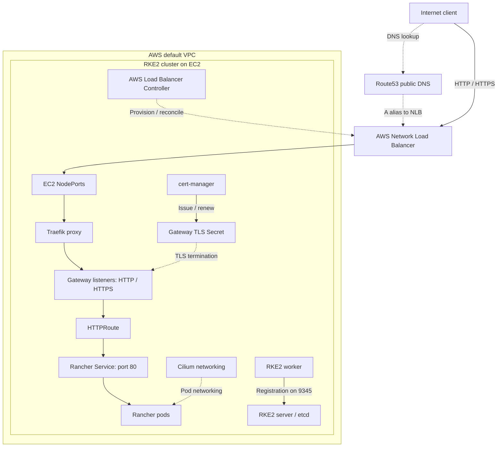

# aws-rke2-rancher-gateway

Terraform and Bash automation for RKE2 and Rancher on AWS, with Traefik Gateway API, an NLB, Route53, Cilium, and cert-manager.

**Author:** [Hassan Hussain](https://github.com/hassanathussain)

## 1. Project Overview

This project provisions a self-managed RKE2 cluster on EC2 and exposes Rancher
through a Kubernetes-managed AWS Network Load Balancer and Traefik Gateway API.
It demonstrates infrastructure provisioning, cluster bootstrap, controller-driven
networking, certificate automation, and operational troubleshooting.

The implementation has been deployed and tested successfully by the author.
The portfolio cleanup preserves that working baseline; it is not a new live
verification or a claim of production high availability.

## 2. Architecture



Gateway and HTTPRoute describe Traefik's routing configuration, not additional
network appliances. Route53 resolves DNS; application traffic does not pass
through Route53. See [architecture and ownership](docs/architecture.md).

## 3. Request Flow

1. The client resolves the Rancher hostname through public DNS.
2. Its HTTP/HTTPS connection reaches the internet-facing NLB.
3. Instance targets forward traffic through EC2 NodePorts to Traefik.
4. Traefik uses the Gateway listeners and HTTPRoute to select the Rancher Service.
5. HTTPS terminates at Traefik; the backend Service receives HTTP on port 80.

The HTTP listener also supports ACME HTTP-01 challenge routing. Both application
listeners currently route to Rancher; no Gateway HTTP-to-HTTPS redirect is defined.

## 4. Provisioning Flow

Terraform discovers the existing default VPC, subnets, public DNS zone, and Ubuntu
AMI, then creates subnet tags, security groups, IAM resources, and server/worker
EC2 instances. It generates the cluster token and Rancher bootstrap password.

EC2 user data installs RKE2 and Cilium. The worker joins the server; the server
waits for two Ready nodes, installs Gateway API CRDs, cert-manager, then Rancher.
It then invokes the embedded migration script to install the AWS Load Balancer
Controller, configure the issuer, disable Rancher's legacy Ingress, install
Traefik, apply Gateway/HTTPRoute resources, discover the NLB, update Route53,
and check certificate readiness and local HTTPS routing.

Terraform does not wait for this complete bootstrap sequence.

## 5. Technology Stack

| Technology | Role |
| --- | --- |
| Terraform, AWS EC2 | Infrastructure provisioning and user-data delivery |
| IAM, security groups | AWS permissions and network access rules |
| RKE2, Kubernetes | Self-managed server/etcd and worker runtime |
| Cilium | Cluster networking |
| Rancher | Kubernetes management UI/API |
| Helm, Bash | Component installation and bootstrap orchestration |
| Traefik, Gateway API, HTTPRoute | Listener configuration and application routing |
| AWS Load Balancer Controller, NLB | Kubernetes-driven external traffic entry |
| Route53 | Existing public zone and script-managed alias cutover |
| cert-manager, ACME HTTP-01 | Gateway certificate issuance and renewal |

## 6. Implemented Capabilities

- One Ubuntu EC2 RKE2 server and one worker, each with a gp3 root disk.
- Cilium networking, AWS provider IDs, and a tainted control-plane node.
- Terraform-generated join token and Rancher bootstrap password.
- Helm-based Rancher and supporting controller installation.
- Traefik Gateway API routing and an internet-facing NLB with instance targets.
- Route53 A-alias update after NLB discovery.
- Let's Encrypt **staging** certificate automation.
- Bounded readiness polls, command retries, and bootstrap logs.
- Credential-free static CI validation.

## 7. Prerequisites

- Terraform >= 1.3.0 and access to the providers selected by the committed lockfile.
- An AWS account and locally configured credential chain with provisioning rights;
  never place credentials in Terraform source or CI.
- An existing default VPC, suitable public subnets, working internet routes,
  and public-address defaults sufficient for EC2 bootstrap downloads.
- An existing EC2 key pair in the selected region.
- An existing public Route53 zone with correctly delegated DNS.
- An administrator CIDR, desired hostname, and ACME contact email.
- Capacity and budget for two EC2 instances, EBS, NLB, DNS, and network charges.

Baseline versions: RKE2 `v1.35.7+rke2r1`, cert-manager `v1.21.1`, Rancher
`2.14.3`, Gateway API CRDs `v1.6.1`. Traefik and AWS Load Balancer Controller
chart versions are not pinned. See [deployment](docs/deployment.md).

## 8. Configuration

Use [terraform.tfvars.example](terraform.tfvars.example) as a fictional template
for a new environment. The real `terraform.tfvars` is ignored. Do not overwrite
an existing deployment's local inputs with examples.

Required inputs are `route53_zone_name`, `ssh_key_name`, and `letsencrypt_email`.
Region, administrator CIDR, subdomain, and component versions retain their baseline
defaults. The baseline administrative CIDR is unrestricted; the example uses a
non-routable documentation address that must be replaced locally.

Passwords and tokens are generated by Terraform, not supplied in the example.
They are still sensitive state/user-data contents.

## 9. Deployment Workflow

Follow [the deployment guide](docs/deployment.md): review local state and inputs,
validate, privately review an authorized plan, provision only with explicit
operator authorization, then observe cloud-init and Kubernetes readiness.
Do not treat a successful Terraform run as proof of application readiness.

Safe static checks:

```bash
terraform fmt -check
terraform init -backend=false -lockfile=readonly
terraform validate
bash -n scripts/user_data_server.sh
bash -n scripts/user_data_worker.sh
bash -n scripts/gateway-migration.sh
```

These commands do not deploy the cluster. GitHub Actions uses no AWS credentials
and never runs a plan or deployment.

## 10. Verification

On an authorized server session, configure the RKE2 PATH and kubeconfig as
shown in [troubleshooting](docs/troubleshooting.md), then inspect nodes, pods,
Traefik's Service, Gateway/HTTPRoute conditions, and cert-manager resources.
Verify public DNS and the NLB request path separately from the script's local
NodePort check. Staging certificates are not publicly trusted.
Never publish raw outputs containing deployment addresses or credentials.

## 11. Repository Structure

Terraform remains at the root; templates and automation live in `scripts/`;
operational explanations live in `docs/`. See the complete
[structure and file responsibilities](docs/repository-structure.md).
Private keys, state, local inputs, provider caches, and original lab notes are
intentionally absent from the public tree.

## 12. Engineering Decisions

The implementation separates Terraform-owned AWS resources from Kubernetes
controller-owned load balancing and script-owned DNS updates. It uses Gateway
API for the Rancher route and cert-manager for the Gateway TLS lifecycle.
[Engineering decisions](docs/engineering-decisions.md) describes the observable
tradeoffs without inventing the author's original motivations.

## 13. Security Considerations

The repository excludes operational secrets, but deployments generate sensitive
state and bootstrap data. Current permissions, network exposure, and staging TLS
are documented in [security considerations](docs/security.md).
See [SECURITY.md](SECURITY.md) for reporting guidance.

## 14. Known Limitations

- Single server/etcd node and single worker; no HA claim.
- Let's Encrypt staging issuer; no publicly trusted production certificate.
- Bootstrap runs asynchronously after EC2 creation.
- NLB and DNS lifecycle is outside direct Terraform resource ownership.
- Existing/default VPC and public connectivity assumptions.
- Latest matching AMI and unpinned controller charts can change future deployments.
- Broad baseline administrative access, shared node IAM role, optional IMDSv2.
- User-data changes can replace EC2 instances.
- The legacy `rancher_ui_url` output uses a server-IP-based hostname; use
  `rancher_dns_url` for the configured Gateway hostname. The output is preserved.

## 15. Troubleshooting / Lessons Learned

[Troubleshooting](docs/troubleshooting.md) covers node readiness, RKE2 tools,
IAM/subnet discovery, NLB targets, NodePorts, Gateway routing, certificate
challenges, and DNS cutover. It records diagnostic areas visible in the
implementation, not invented incidents or performance measurements.

## 16. Production Roadmap

**Future improvements only:** HA, additional workers, narrower access/IAM,
IMDSv2 enforcement, protected remote state and locking, off-node etcd backups,
restore testing, observability, stronger version pinning, production ACME,
HTTPS enforcement, and automated lifecycle cleanup.
None is implemented as part of the portfolio cleanup.
See [production roadmap](docs/production-roadmap.md).

## 17. Skills Demonstrated

Infrastructure as code; AWS identity and networking; Linux/cloud-init automation;
self-managed Kubernetes bootstrap; CNI integration; Helm lifecycle management;
Gateway API routing; controller-based load balancing; ACME/TLS automation;
DNS integration; operational diagnostics; static CI; and responsible publication
of infrastructure source without operational secrets.

Licensed under the [MIT License](LICENSE).
